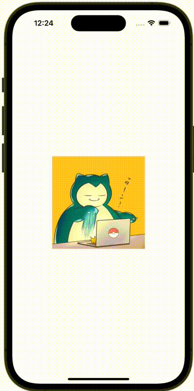

+++
title = "SwiftUIで画像をピンチで拡大する（MagnificationGesture）"
url = "2023-12-29"
date = "2023-12-29"
description = "SwiftUIで画像をピンチで拡大する（MagnificationGesture）"
tags = ["Swift", "SwiftUI"]
categories = ["SwiftUI"]
archives = "2023/12"
+++

<br>

SwiftUIでPreviewを横向きにする方法です。



<!--more-->

**ContentView.swift**

```swift
import SwiftUI

struct ContentView: View {
    @State var scale: CGFloat = 1.0
    
    var body: some View {
        Image(.icon)
            .resizable()
            .scaleEffect(scale)
            .frame(width: 200, height: 200)
            .gesture(MagnificationGesture()
                .onChanged { value in
                    scale = value.magnitude
                }
            )
    }
}

#Preview {
    ContentView()
}
```

