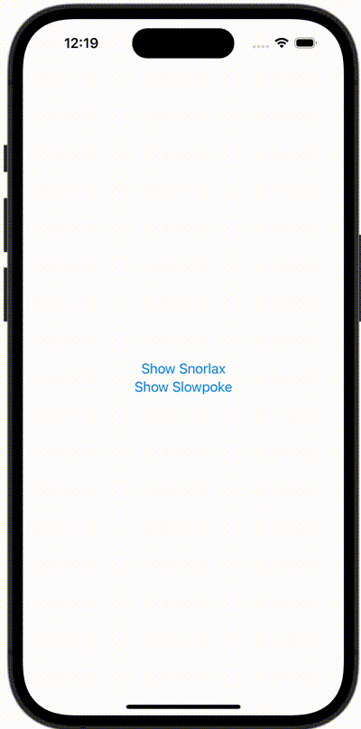

+++
title = "SwiftUIでシートを出し分ける"
url = "2024-01-02"
date = "2024-01-02"
description = "SwiftUIでシートを出し分ける"
tags = ["Swift", "SwiftUI"]
categories = ["SwiftUI"]
archives = "2024/01"
+++

<br>

SwiftUIでシートを出し分ける方法です。




<!--more-->

**ContentView.swift**

```swift
import SwiftUI

struct ContentView: View {
    @State var showingSnorlaxView = false
    @State var showingSlowpokeView = false
    
    var body: some View {
        VStack {
            Button(action: {
                showingSnorlaxView = true
            }) {
                Text("Show Snorlax")
            }
            
            Button(action: {
                showingSlowpokeView = true
            }) {
                Text("Show Slowpoke")
            }
        }
        .sheet(isPresented: $showingSnorlaxView) {
            SnorlaxView()
        }
        .sheet(isPresented: $showingSlowpokeView) {
            SlowpokeView()
        }
    }
}

#Preview {
    ContentView()
}
```


**SlowpokeView.swift**

```swift
import SwiftUI

struct SlowpokeView: View {
    var body: some View {
        Image(.slowpoke)
            .resizable()
            .frame(width: 150, height: 150)
            .scaledToFit()
    }
}
```


**SnorlaxView.swift**

```swift
import SwiftUI

struct SnorlaxView: View {
    var body: some View {
        Image(.snorlax)
            .resizable()
            .frame(width: 150, height: 150)
            .scaledToFit()
    }
}
```


