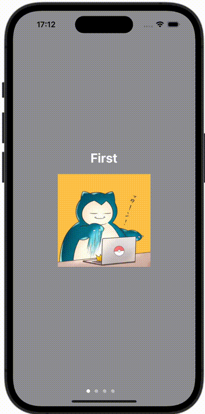

+++
title = "SwiftUIでPageControlを使用する"
url = "2024-01-03"
date = "2024-01-03"
description = "SwiftUIでPageControlを使用する"
tags = ["Swift", "SwiftUI"]
categories = ["SwiftUI"]
archives = "2024/01"
+++

<br>

SwiftUIでPageControlを使用する方法です。




<!--more-->

**ContentView.swift**

```swift
import SwiftUI

struct ContentView: View {
    @State var views = [
        TutorialView(image: Image(.snorlax), text: "First"),
        TutorialView(image: Image(.pikachu), text: "Second"),
        TutorialView(image: Image(.slowpoke), text: "Third"),
        TutorialView(image: Image(.magikarp), text: "Fourth"),
    ]

    var body: some View {
        PageView(views)
            .background(Color.gray)
            .edgesIgnoringSafeArea(.all)
    }
}
```


**PageControl.swift**

```swift
import SwiftUI

struct PageControl: UIViewRepresentable {
    var numberOfPages: Int
    @Binding var currentPage: Int

    func makeCoordinator() -> Coordinator {
        Coordinator(self)
    }

    func makeUIView(context: Context) -> UIPageControl {
        let control = UIPageControl()
        control.numberOfPages = numberOfPages
        control.addTarget(
            context.coordinator,
            action: #selector(Coordinator.updateCurrentPage(sender:)),
            for: .valueChanged)

        return control
    }

    func updateUIView(_ uiView: UIPageControl, context: Context) {
        uiView.currentPage = currentPage
    }

    class Coordinator: NSObject {
        var control: PageControl

        init(_ control: PageControl) {
            self.control = control
        }

        @objc
        func updateCurrentPage(sender: UIPageControl) {
            control.currentPage = sender.currentPage
        }
    }
}
```


**PageView.swift**

```swift
import SwiftUI

struct PageView<Page: View>: View {
    var viewControllers: [UIHostingController<Page>]
    @State var currentPage = 0

    init(_ views: [Page]) {
        self.viewControllers = views.map { UIHostingController(rootView: $0) }
    }

    var body: some View {
        ZStack(alignment: .bottom) {
            PageViewController(controllers: viewControllers, currentPage: $currentPage)
            PageControl(numberOfPages: viewControllers.count, currentPage: $currentPage)
                .padding(.trailing)
                .padding(.bottom, 20)
        }
    }
}
```


**PageViewController.swift**

```swift
import SwiftUI

struct PageViewController: UIViewControllerRepresentable {
    var controllers: [UIViewController]
    @Binding var currentPage: Int

    func makeCoordinator() -> Coordinator {
        Coordinator(self)
    }

    func makeUIViewController(context: Context) -> UIPageViewController {
        let pageViewController = UIPageViewController(
            transitionStyle: .scroll,
            navigationOrientation: .horizontal)
        pageViewController.dataSource = context.coordinator
        pageViewController.delegate = context.coordinator

        return pageViewController
    }

    func updateUIViewController(_ pageViewController: UIPageViewController, context: Context) {
        pageViewController.setViewControllers(
            [controllers[currentPage]], direction: .forward, animated: true)
    }

    class Coordinator: NSObject, UIPageViewControllerDataSource, UIPageViewControllerDelegate {
        var parent: PageViewController

        init(_ pageViewController: PageViewController) {
            self.parent = pageViewController
        }

        func pageViewController(
            _ pageViewController: UIPageViewController,
            viewControllerBefore viewController: UIViewController) -> UIViewController?
        {
            guard let index = parent.controllers.firstIndex(of: viewController) else {
                return nil
            }

            if index == 0 {
                return nil
            }
            return parent.controllers[index - 1]
        }

        func pageViewController(
            _ pageViewController: UIPageViewController,
            viewControllerAfter viewController: UIViewController) -> UIViewController?
        {
            guard let index = parent.controllers.firstIndex(of: viewController) else {
                return nil
            }

            if index + 1 == parent.controllers.count {
                return nil
            }
            return parent.controllers[index + 1]
        }

        func pageViewController(_ pageViewController: UIPageViewController, didFinishAnimating finished: Bool, previousViewControllers: [UIViewController], transitionCompleted completed: Bool) {
            if completed,
                let visibleViewController = pageViewController.viewControllers?.first,
                let index = parent.controllers.firstIndex(of: visibleViewController)
            {
                parent.currentPage = index
            }
        }
    }
}
```


**TutorialView.swift**

```swift
import SwiftUI

struct TutorialView: View {
    let image: Image
    let text: String
    var body: some View {
        VStack {
            Text(text)
                .font(.title.bold())
                .foregroundStyle(Color.white)
            
            image
                .resizable()
                .scaledToFit()
                .frame(width: 200, height: 200)
                .background(Color.white)
        }
        .frame(minWidth: 0, maxWidth: .infinity, minHeight: 0, maxHeight: .infinity)
        .background(Color.gray)
        .edgesIgnoringSafeArea(.all)
    }
}
```


