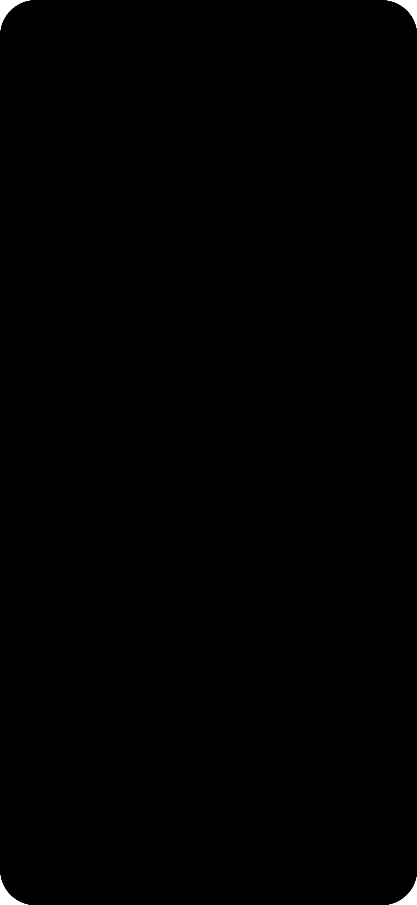
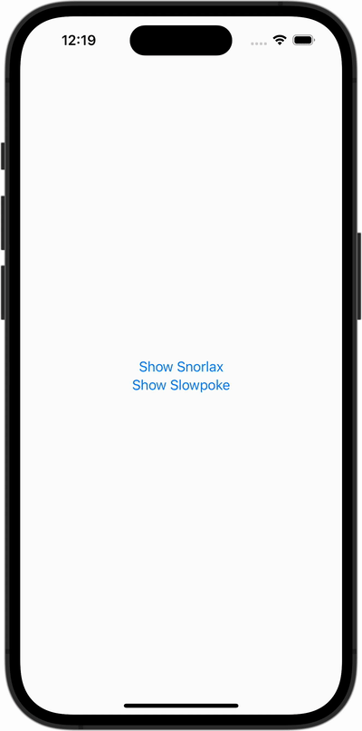

+++
title = "iPhoneシミュレーターの録画に端末の枠を付ける"
url = "2026-10-14"
date = "2026-10-14"
description = "iPhoneシミュレーターの画面を録画し、FFmpegで角丸のマスクと端末の枠を合成して、MP4やGIFにする方法です。"
tags = ["FFmpeg", "iOS", "Terminal", "Xcode"]
categories = ["FFmpeg", "iOS"]
archives = "2026/10"
+++

iPhoneシミュレーターで録画した画面に、PNGの端末フレームを重ねて枠付きの動画を作る方法です。

画面を録画してから、FFmpegで角を丸くし、余白と端末の枠を付けます。こんな動画になります。

<video controls loop muted playsinline preload="metadata" width="300" style="max-width:100%;height:auto" poster="preview.png">
  <source src="framed.mp4" type="video/mp4">
  <a href="framed.mp4">枠付きの動画をダウンロード</a>
</video>

<!--more-->

## 準備するもの

Xcodeと、FFmpegを使用します。FFmpegはHomebrewでインストールできます。

```sh
brew install ffmpeg
```

合成に使うファイルを同じディレクトリに置きます。今回の例で使った素材もダウンロードできます。

| ファイル | 用途 | 今回のサイズ |
| --- | --- | --- |
| [recording.mp4](recording.mp4) | 枠のない画面録画 | 1178 × 2556 |
| [frame.png](frame.png) | 画面部分が透明な端末の枠 | 1326 × 2676 |
| [screen-mask.png](screen-mask.png) | 画面の角丸を作るPNG | 1179 × 2556 |

枠の画像は画面部分を透明にしておきます。別の機種や録画サイズを使う場合は、画面部分の大きさと位置が録画に合う枠・マスクを用意してください。

今回の枠には高解像度版を使用しています。[小さい枠のPNG（220 × 444）](frame-small.png)もありますが、大きい動画への合成には高解像度版を使うと輪郭がぼやけにくくなります。

## シミュレーターの画面を録画する

シミュレーターでアプリを起動し、ターミナルで次のコマンドを実行します。

```sh
xcrun simctl io booted recordVideo --codec=h264 recording.mp4
```

録画中にシミュレーターを操作し、終わったらターミナルで `Control + C` を押します。録画ファイルの保存が完了し、コマンドが終了するまで待ってください。

`booted` は起動中のシミュレーターを指します。複数起動している場合は、`xcrun simctl list devices booted` で確認した対象のUDIDを `booted` の代わりに指定します。

録画した動画のサイズは、次のコマンドで確認できます。

```sh
ffprobe -v error -select_streams v:0 \
  -show_entries stream=width,height -of csv=p=0:s=x recording.mp4
```

ここから先の数値は、今回の素材に合わせたものです。録画が `1178x2556` 以外の場合は、サイズと位置を調整してください。

## 余白と枠の位置を決める

今回の動画は1178 × 2556、枠は1326 × 2676なので、横に148px、縦に120pxの余白を追加します。動画の左上を枠の中の `x=74`、`y=59` に置きます。

```sh
ffmpeg -i recording.mp4 \
  -vf "fps=30,pad=1326:2676:74:59:color=white" \
  -an -c:v libx264 -pix_fmt yuv420p movie-padding.mp4
```

`pad` の数値は、出力の幅・高さ・動画を置くX座標・Y座標の順です。この例では、左74px・右74px・上59px・下61pxの余白になります。

枠のPNGは余白を付けた動画と同じ大きさなので、画像を重ねる位置は `0:0` です。動画の位置と枠画像の位置を別々にずらすと、画面と枠が合わなくなります。

## 角丸のマスクと枠を合成する

角丸の外側が透明な `screen-mask.png` から、`alphaextract` で透明度を取り出し、録画した動画の透明度として使用します。

今回使ったマスクはこちらです。黒く見える不透明な部分に録画した画面を残し、角の透明な部分は隠します。透明部分が分かるよう、表示の背景に市松模様を敷いています。

<figure style="margin:1.5em 0">
  <a href="screen-mask.png" download style="display:inline-block;padding:12px;max-width:100%;box-sizing:border-box;background-color:#fff;background-image:conic-gradient(#ddd 25%,#fff 0 50%,#ddd 0 75%,#fff 0);background-size:16px 16px;background-repeat:repeat">
    
  </a>
  <figcaption>角丸マスク（1179 × 2556）。画像をクリックすると合成用のPNGをダウンロードできます。</figcaption>
</figure>

このマスクは黒い画像ですが、形状はRGBの色ではなくアルファチャンネルに入っています。黒い部分をそのまま `alphamerge` に渡すと画面まで透明になるため、先に透明度を取り出します。マスクの幅は録画より1px大きいので、録画と同じ1178 × 2556へ揃えます。

角丸・余白・枠の合成をまとめて行うコマンドです。

```sh
ffmpeg -i recording.mp4 \
  -loop 1 -i frame.png \
  -loop 1 -i screen-mask.png \
  -filter_complex \
  "[0:v]fps=30,format=rgba[screen]; \
   [2:v]alphaextract,scale=1178:2556[alpha]; \
   [screen][alpha]alphamerge=shortest=1[rounded]; \
   [rounded]pad=1326:2676:74:59:color=white[padded]; \
   [padded][1:v]overlay=0:0:shortest=1,format=yuv420p[v]" \
  -map "[v]" -an \
  -c:v libx264 -crf 20 -preset medium \
  -movflags +faststart framed.mp4
```

`-loop 1` でPNGを動画の最後まで使い、`shortest=1` で録画の終了に合わせて合成も終了します。出力はH.264・30fpsのMP4です。ここでは音声を付けず、`+faststart` でウェブ上でも再生を始めやすい配置にしています。

今回の約5.2秒の録画から、1326 × 2676の枠付きMP4を作成できました。

## GIFに変換する

ブログなどでGIFとして表示したい場合は、枠付きのMP4を変換します。パレットを作ってから適用すると、単純に拡張子をGIFに変える変換より色を調整しやすくなります。

```sh
ffmpeg -i framed.mp4 \
  -filter_complex \
  "fps=12,scale=400:-1:flags=lanczos,split[a][b]; \
   [a]palettegen[p];[b][p]paletteuse" \
  framed.gif
```

横幅を400px、フレームレートを12fpsにしています。出力したGIFはこちらです。



実行済みのコマンドをもう一度使う場合、FFmpegは既存ファイルを上書きするか確認します。残したい動画がある場合は出力ファイル名を変えてください。

## 参考

- [Apple: Capturing screenshots and videos from devices](https://developer.apple.com/documentation/xcode/capturing-screenshots-and-videos-from-devices)
- [FFmpeg: alphaextract・alphamerge・pad・overlay・palettegen・paletteuse](https://ffmpeg.org/ffmpeg-filters.html)

コマンドの構文はXcode 27.0の `simctl io` ヘルプで確認し、合成とGIF変換はFFmpeg 7.1.1で上記の素材を使って検証しました。
